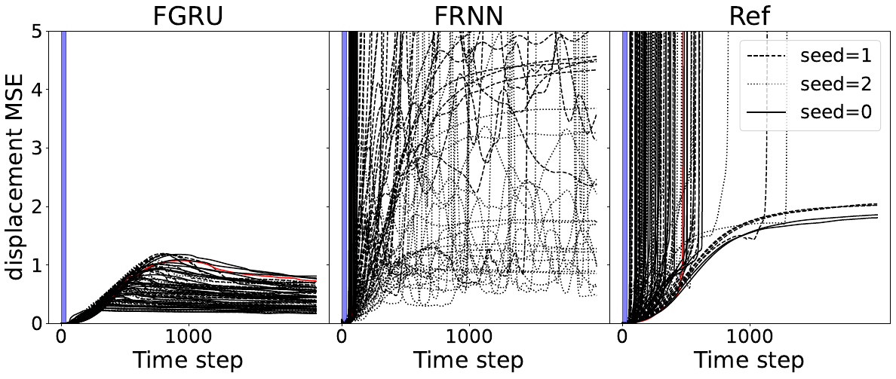
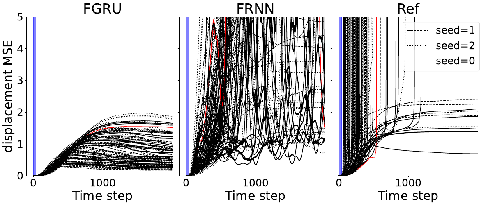
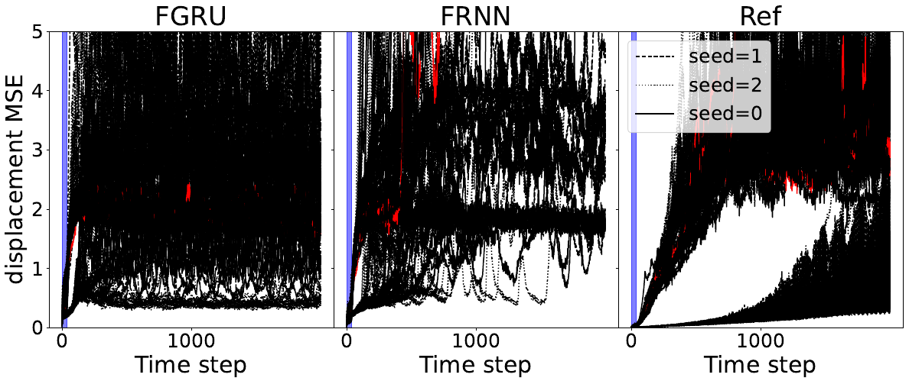
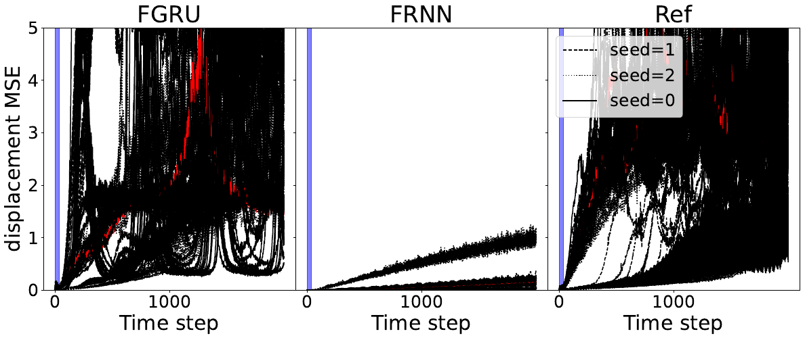
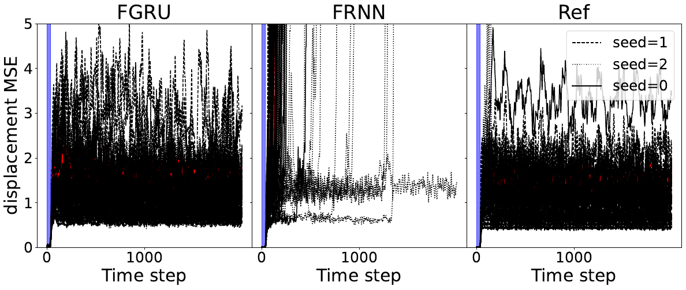
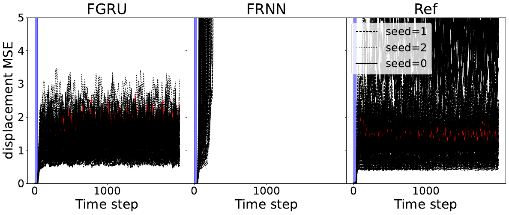

# Full-spectrum sweep: results

This document gives the results of the full sweep in `slurm/fullsweep.sbatch` (144 tasks, 72 run directories).
The sweep compares two changes to the training of the paper:

- **Spectrum:** the original `FourierConv2d` keeps only the kx >= 0 half of the 2D spectrum.
  The full-spectrum layer (`nnarch.full_spectrum=true`) also keeps the kx < 0 half.
  The change applies to FGRU and FRNN; REF uses `SpectralConv2d`, which keeps both halves.
- **Gradient clipping:** the paper clips the concatenated gradients of FGRU, FRNN and REF together (joint clipping).
  Separate clipping (`train.clip_jointly=false`) clips the gradients of each model on its own.

The sweep has 6 datasets x seeds 0–2 x {original, full spectrum} x {joint, separate clipping}.
The "original, joint" runs replicate the paper's runs; the [caveats](#caveats) list the differences from the paper.

## Summary

1. **The replication agrees with the paper in its main points.**
   FGRU has approximately the validation MSE of the paper, and it does not diverge in 2000 steps.
   FRNN and REF diverge frequently, as in the paper.
   FRNN and REF have a higher validation MSE than in the paper (about 3x for FRNN, 1.2–1.5x for REF).
2. **The full spectrum decreases the validation MSE of FGRU by about 7–12x on the plate datasets.**
   For FRNN, the decrease is about 5–12x, except at γ=100, κ=0.1 (about 2x).
   On the FTM 2D wave dataset, the decrease is 40–100x for FGRU and about 400x for FRNN.
   With the full spectrum, FGRU and FRNN have a lower validation MSE than REF on all 6 datasets.
   With separate clipping, the REF results are identical for the two spectra, as expected.
3. **With the original spectrum, FGRU and FRNN cannot learn the FTM 2D wave dataset** (validation MSE 0.17–0.18, against 0.004 for REF).
   With the full spectrum, their MSE is 0.0004–0.005.
4. **Separate clipping decreases the validation MSE of FGRU with the original spectrum by about 1.6–2x on the plate datasets.**
   With the full spectrum, the effect of the clipping mode is small, except on the two datasets that are not in the paper.
   Under joint clipping, the full spectrum changes REF too, because the clipping couples the models: on the FTM 2D wave dataset, the REF MSE increases from 0.0039 to 0.0065.
5. **The full spectrum stops the divergence of FRNN on the plate γ=1, κ=0.1 and on the FTM 2D wave dataset.**
   On the plate γ=1, κ=1, the rate decreases to 0.01 with separate clipping (0.27 with joint clipping).
   At γ=100, the rate decreases but stays between 0.33 and 0.87; on the undamped plate, almost all FRNN predictions diverge with both spectra.
6. **A rate of 0 diverging runs does not mean an accurate long-term prediction.**
   At step 2000, the MSE of FGRU is approximately equal to, or more than, the MSE of a zero prediction on all 5 plate datasets, for all 4 variants.
   For FGRU on the plate datasets, the full spectrum decreases the MSE at step 39 (the end of the training horizon) by about 8–17x, but it does not decrease the MSE at step 2000.
   The only model that stays accurate for 2000 steps is the full-spectrum FRNN on the FTM 2D wave dataset (MSE 0.12, against 0.92 for a zero prediction).

## Datasets

| Dataset | Solver | Initial conditions | In the paper |
|---|---|---|---|
| Plate γ=1, κ=0.1; γ=1, κ=1; γ=100, κ=0.1; γ=100, κ=1 | Linear plate, frequency-dependent damping | Plucks | Yes |
| Plate γ=340, κ=0 (no damping) | Linear plate with the wave speed of the 2D wave equation of Parker et al. | Plucks | No |
| FTM 2D wave | 2D wave equation of Parker et al. (FTM, 25 modes, 3 channels), 40 steps | Half impulses, half random fields | No |

Each training dataset has 1024 trajectories of 40 steps (data seed 0); the last 10% are the validation set.
Each extrapolation dataset has 30 trajectories of 2000 steps (data seed 5).
All MSE values are in normalised units: each channel is divided by its standard deviation over the training split.
For the FTM 2D wave dataset, "displacement" is the pressure and "velocity" is the x-velocity.

## Validation MSE

Mean (std) over the 3 seeds, on the validation set of the run's own dataset, over steps 1–39.
The paper column is from the paper's validation table; its values are the mean (std) over 9 (model, validation set) pairs, and * excludes a single diverging evaluation.

### Displacement

| Dataset | Model | Original, joint | Full, joint | Original, separate | Full, separate | Paper |
|---|---|---|---|---|---|---|
| Plate γ=1, κ=0.1 | FGRU | 0.0007 (0.0001) | 0.0001 (0.0000) | 0.0004 (0.0001) | 0.0001 (0.0000) | 0.0007 (0.0001) |
| Plate γ=1, κ=0.1 | FRNN | 0.0093 (0.0073) | 0.0008 (0.0001) | 0.0054 (0.0038) | 0.0009 (0.0002) | 0.0028 (0.0024) |
| Plate γ=1, κ=0.1 | REF | 0.0023 (0.0004) | 0.0023 (0.0004) | 0.0024 (0.0003) | 0.0026 (0.0002) | 0.0019 (0.0009) |
| Plate γ=1, κ=1 | FGRU | 0.0048 (0.0007) | 0.0004 (0.0001) | 0.0026 (0.0003) | 0.0004 (0.0000) | 0.0039 (0.0007) |
| Plate γ=1, κ=1 | FRNN | 0.0063 (0.0045) | 0.0008 (0.0002) | 0.0042 (0.0026) | 0.0008 (0.0004) | 0.0020 (0.0014) |
| Plate γ=1, κ=1 | REF | 0.0034 (0.0006) | 0.0036 (0.0005) | 0.0038 (0.0008) | 0.0036 (0.0008) | 0.0023 (0.0005)* |
| Plate γ=100, κ=0.1 | FGRU | 0.0045 (0.0008) | 0.0004 (0.0002) | 0.0027 (0.0004) | 0.0006 (0.0003) | 0.0050 (0.0002) |
| Plate γ=100, κ=0.1 | FRNN | 0.0031 (0.0040) | 0.0016 (0.0016) | 0.0022 (0.0023) | 0.0010 (0.0004) | 0.0011 (0.0007) |
| Plate γ=100, κ=0.1 | REF | 0.0024 (0.0006) | 0.0026 (0.0009) | 0.0026 (0.0009) | 0.0026 (0.0008) | 0.0017 (0.0002) |
| Plate γ=100, κ=1 | FGRU | 0.0065 (0.0004) | 0.0007 (0.0002) | 0.0040 (0.0005) | 0.0006 (0.0003) | 0.0072 (0.0002) |
| Plate γ=100, κ=1 | FRNN | 0.0040 (0.0051) | 0.0008 (0.0003) | 0.0032 (0.0034) | 0.0007 (0.0001) | 0.0012 (0.0003) |
| Plate γ=100, κ=1 | REF | 0.0024 (0.0007) | 0.0024 (0.0008) | 0.0027 (0.0009) | 0.0026 (0.0009) | 0.0016 (0.0001) |
| Plate γ=340, κ=0 (no damping) | FGRU | 0.0278 (0.0039) | 0.0027 (0.0005) | 0.0134 (0.0035) | 0.0016 (0.0004) | – |
| Plate γ=340, κ=0 (no damping) | FRNN | 0.0053 (0.0015) | 0.0006 (0.0003) | 0.0050 (0.0011) | 0.0006 (0.0003) | – |
| Plate γ=340, κ=0 (no damping) | REF | 0.0069 (0.0033) | 0.0078 (0.0046) | 0.0074 (0.0036) | 0.0074 (0.0037) | – |
| FTM 2D wave | FGRU | 0.1837 (0.0055) | 0.0046 (0.0007) | 0.1725 (0.0029) | 0.0018 (0.0004) | – |
| FTM 2D wave | FRNN | 0.1756 (0.0037) | 0.0004 (0.0002) | 0.1731 (0.0044) | 0.0004 (0.0002) | – |
| FTM 2D wave | REF | 0.0039 (0.0005) | 0.0065 (0.0028) | 0.0040 (0.0006) | 0.0040 (0.0006) | – |

### Velocity

| Dataset | Model | Original, joint | Full, joint | Original, separate | Full, separate |
|---|---|---|---|---|---|
| Plate γ=1, κ=0.1 | FGRU | 0.0064 (0.0021) | 0.0009 (0.0006) | 0.0030 (0.0003) | 0.0006 (0.0001) |
| Plate γ=1, κ=0.1 | FRNN | 0.0204 (0.0153) | 0.0032 (0.0009) | 0.0125 (0.0079) | 0.0029 (0.0008) |
| Plate γ=1, κ=0.1 | REF | 0.0091 (0.0019) | 0.0089 (0.0013) | 0.0091 (0.0019) | 0.0096 (0.0019) |
| Plate γ=1, κ=1 | FGRU | 0.0122 (0.0024) | 0.0011 (0.0001) | 0.0065 (0.0008) | 0.0010 (0.0001) |
| Plate γ=1, κ=1 | FRNN | 0.0183 (0.0126) | 0.0026 (0.0007) | 0.0118 (0.0070) | 0.0026 (0.0015) |
| Plate γ=1, κ=1 | REF | 0.0095 (0.0015) | 0.0100 (0.0009) | 0.0108 (0.0024) | 0.0109 (0.0028) |
| Plate γ=100, κ=0.1 | FGRU | 0.0074 (0.0016) | 0.0008 (0.0003) | 0.0041 (0.0008) | 0.0010 (0.0005) |
| Plate γ=100, κ=0.1 | FRNN | 0.0055 (0.0068) | 0.0032 (0.0038) | 0.0046 (0.0050) | 0.0017 (0.0006) |
| Plate γ=100, κ=0.1 | REF | 0.0042 (0.0008) | 0.0044 (0.0012) | 0.0046 (0.0012) | 0.0046 (0.0011) |
| Plate γ=100, κ=1 | FGRU | 0.0123 (0.0012) | 0.0013 (0.0005) | 0.0073 (0.0010) | 0.0012 (0.0005) |
| Plate γ=100, κ=1 | FRNN | 0.0090 (0.0107) | 0.0015 (0.0006) | 0.0077 (0.0078) | 0.0013 (0.0002) |
| Plate γ=100, κ=1 | REF | 0.0055 (0.0013) | 0.0053 (0.0013) | 0.0061 (0.0017) | 0.0060 (0.0017) |
| Plate γ=340, κ=0 (no damping) | FGRU | 0.0486 (0.0069) | 0.0063 (0.0011) | 0.0241 (0.0046) | 0.0034 (0.0007) |
| Plate γ=340, κ=0 (no damping) | FRNN | 0.0147 (0.0039) | 0.0015 (0.0009) | 0.0140 (0.0030) | 0.0015 (0.0008) |
| Plate γ=340, κ=0 (no damping) | REF | 0.0124 (0.0031) | 0.0134 (0.0047) | 0.0133 (0.0035) | 0.0133 (0.0037) |
| FTM 2D wave | FGRU | 0.2051 (0.0057) | 0.0053 (0.0011) | 0.1951 (0.0037) | 0.0019 (0.0005) |
| FTM 2D wave | FRNN | 0.2009 (0.0038) | 0.0005 (0.0002) | 0.1980 (0.0048) | 0.0005 (0.0002) |
| FTM 2D wave | REF | 0.0046 (0.0007) | 0.0082 (0.0042) | 0.0047 (0.0008) | 0.0047 (0.0008) |

## Rate of diverging runs in 2000 steps

Mean [min, max] over the 3 seeds of the fraction of (IC, channel) pairs whose MSE becomes infinite in 2000 steps, on the 30 extrapolation ICs.
This is the rule of the paper.
A prediction that stays finite but is incorrect does not count as diverging.

| Dataset | Model | Original, joint | Full, joint | Original, separate | Full, separate | Paper |
|---|---|---|---|---|---|---|
| Plate γ=1, κ=0.1 | FGRU | 0.00 [0.00, 0.00] | 0.00 [0.00, 0.00] | 0.00 [0.00, 0.00] | 0.00 [0.00, 0.00] | 0.00 [0.00, 0.00] |
| Plate γ=1, κ=0.1 | FRNN | 0.35 [0.00, 1.00] | 0.00 [0.00, 0.00] | 0.74 [0.27, 1.00] | 0.00 [0.00, 0.00] | 0.83 [0.50, 1.00] |
| Plate γ=1, κ=0.1 | REF | 0.94 [0.90, 1.00] | 0.88 [0.80, 0.97] | 0.83 [0.57, 0.97] | 0.79 [0.70, 0.87] | 0.76 [0.60, 0.93] |
| Plate γ=1, κ=1 | FGRU | 0.00 [0.00, 0.00] | 0.00 [0.00, 0.00] | 0.00 [0.00, 0.00] | 0.00 [0.00, 0.00] | 0.00 [0.00, 0.00] |
| Plate γ=1, κ=1 | FRNN | 0.36 [0.00, 1.00] | 0.27 [0.00, 0.53] | 0.34 [0.00, 1.00] | 0.01 [0.00, 0.03] | 0.33 [0.00, 1.00] |
| Plate γ=1, κ=1 | REF | 0.68 [0.07, 1.00] | 0.53 [0.03, 0.90] | 0.70 [0.10, 1.00] | 0.67 [0.07, 1.00] | 0.68 [0.03, 1.00] |
| Plate γ=100, κ=0.1 | FGRU | 0.00 [0.00, 0.00] | 0.00 [0.00, 0.00] | 0.00 [0.00, 0.00] | 0.00 [0.00, 0.00] | 0.00 [0.00, 0.00] |
| Plate γ=100, κ=0.1 | FRNN | 0.80 [0.40, 1.00] | 0.54 [0.00, 1.00] | 0.99 [0.97, 1.00] | 0.33 [0.00, 1.00] | 0.32 [0.00, 0.63] |
| Plate γ=100, κ=0.1 | REF | 0.99 [0.97, 1.00] | 1.00 [1.00, 1.00] | 0.98 [0.93, 1.00] | 1.00 [1.00, 1.00] | 0.99 [0.97, 1.00] |
| Plate γ=100, κ=1 | FGRU | 0.00 [0.00, 0.00] | 0.00 [0.00, 0.00] | 0.00 [0.00, 0.00] | 0.00 [0.00, 0.00] | 0.00 [0.00, 0.00] |
| Plate γ=100, κ=1 | FRNN | 0.96 [0.87, 1.00] | 0.63 [0.00, 0.97] | 1.00 [1.00, 1.00] | 0.87 [0.60, 1.00] | 0.83 [0.60, 1.00] |
| Plate γ=100, κ=1 | REF | 1.00 [1.00, 1.00] | 1.00 [1.00, 1.00] | 1.00 [1.00, 1.00] | 1.00 [1.00, 1.00] | 1.00 [1.00, 1.00] |
| Plate γ=340, κ=0 (no damping) | FGRU | 0.00 [0.00, 0.00] | 0.00 [0.00, 0.00] | 0.00 [0.00, 0.00] | 0.00 [0.00, 0.00] | – |
| Plate γ=340, κ=0 (no damping) | FRNN | 0.99 [0.97, 1.00] | 1.00 [1.00, 1.00] | 0.97 [0.90, 1.00] | 1.00 [1.00, 1.00] | – |
| Plate γ=340, κ=0 (no damping) | REF | 0.00 [0.00, 0.00] | 0.00 [0.00, 0.00] | 0.33 [0.00, 1.00] | 0.29 [0.00, 0.87] | – |
| FTM 2D wave | FGRU | 0.00 [0.00, 0.00] | 0.00 [0.00, 0.00] | 0.00 [0.00, 0.00] | 0.00 [0.00, 0.00] | – |
| FTM 2D wave | FRNN | 0.79 [0.43, 1.00] | 0.00 [0.00, 0.00] | 0.79 [0.47, 1.00] | 0.00 [0.00, 0.00] | – |
| FTM 2D wave | REF | 0.00 [0.00, 0.00] | 0.00 [0.00, 0.00] | 0.00 [0.00, 0.00] | 0.00 [0.00, 0.00] | – |

## Long-term accuracy

The rate of diverging runs does not show if a finite prediction is accurate.
The tables below give the displacement MSE at two steps: the median over the 30 extrapolation ICs (an IC that diverged counts as infinite), then the median over the 3 seeds.
The zero-prediction column is the MSE of a prediction of 0 at the last step, which is the mean square of the target.
An MSE near this value shows that the prediction has no useful information about the target.
`final_mse.py` in this directory calculates these values.

### Step 39 (the last step of the training horizon)

| Dataset | Model | Original, joint | Full, joint | Original, separate | Full, separate |
|---|---|---|---|---|---|
| Plate γ=1, κ=0.1 | FGRU | 0.00078 | 8.3e-05 | 0.00048 | 7e-05 |
| Plate γ=1, κ=0.1 | FRNN | 0.012 | 0.0012 | 0.0079 | 0.0011 |
| Plate γ=1, κ=0.1 | REF | 0.0036 | 0.0035 | 0.0036 | 0.0036 |
| Plate γ=1, κ=1 | FGRU | 0.0069 | 0.00079 | 0.0039 | 0.00059 |
| Plate γ=1, κ=1 | FRNN | 0.009 | 0.0013 | 0.0066 | 0.001 |
| Plate γ=1, κ=1 | REF | 0.0081 | 0.0085 | 0.0094 | 0.0093 |
| Plate γ=100, κ=0.1 | FGRU | 0.011 | 0.00083 | 0.0064 | 0.0011 |
| Plate γ=100, κ=0.1 | FRNN | 0.0014 | 0.0011 | 0.0015 | 0.0014 |
| Plate γ=100, κ=0.1 | REF | 0.0034 | 0.0034 | 0.0038 | 0.0038 |
| Plate γ=100, κ=1 | FGRU | 0.015 | 0.0009 | 0.0095 | 0.0011 |
| Plate γ=100, κ=1 | FRNN | 0.0016 | 0.0012 | 0.0017 | 0.0012 |
| Plate γ=100, κ=1 | REF | 0.0032 | 0.0034 | 0.0034 | 0.0035 |
| Plate γ=340, κ=0 (no damping) | FGRU | 0.057 | 0.0068 | 0.027 | 0.0042 |
| Plate γ=340, κ=0 (no damping) | FRNN | 0.015 | 0.0015 | 0.015 | 0.0016 |
| Plate γ=340, κ=0 (no damping) | REF | 0.03 | 0.03 | 0.031 | 0.03 |
| FTM 2D wave | FGRU | 0.28 | 0.0072 | 0.23 | 0.0026 |
| FTM 2D wave | FRNN | 0.24 | 0.00047 | 0.23 | 0.00047 |
| FTM 2D wave | REF | 0.0072 | 0.011 | 0.0075 | 0.0074 |

### Step 1999 (the last step of the extrapolation)

| Dataset | Model | Original, joint | Full, joint | Original, separate | Full, separate | Zero prediction |
|---|---|---|---|---|---|---|
| Plate γ=1, κ=0.1 | FGRU | 0.42 | 0.73 | 0.42 | 0.68 | 0.42 |
| Plate γ=1, κ=0.1 | FRNN | 8.7 | 13 | ∞ | 4.6 | 0.42 |
| Plate γ=1, κ=0.1 | REF | ∞ | ∞ | ∞ | ∞ | 0.42 |
| Plate γ=1, κ=1 | FGRU | 0.47 | 0.77 | 0.51 | 0.62 | 0.46 |
| Plate γ=1, κ=1 | FRNN | 1.1 | 1.4 | 1.2 | 1.4 | 0.46 |
| Plate γ=1, κ=1 | REF | ∞ | ∞ | ∞ | ∞ | 0.46 |
| Plate γ=100, κ=0.1 | FGRU | 0.98 | 1.1 | 1 | 1.3 | 0.76 |
| Plate γ=100, κ=0.1 | FRNN | ∞ | ∞ | ∞ | 1.2 | 0.76 |
| Plate γ=100, κ=0.1 | REF | ∞ | ∞ | ∞ | ∞ | 0.76 |
| Plate γ=100, κ=1 | FGRU | 1 | 0.82 | 0.88 | 0.82 | 0.69 |
| Plate γ=100, κ=1 | FRNN | ∞ | ∞ | ∞ | ∞ | 0.69 |
| Plate γ=100, κ=1 | REF | ∞ | ∞ | ∞ | ∞ | 0.69 |
| Plate γ=340, κ=0 (no damping) | FGRU | 1.2 | 1.4 | 1.3 | 1.3 | 1.1 |
| Plate γ=340, κ=0 (no damping) | FRNN | ∞ | ∞ | ∞ | ∞ | 1.1 |
| Plate γ=340, κ=0 (no damping) | REF | 1.1 | 1.6 | 1.1 | 1.1 | 1.1 |
| FTM 2D wave | FGRU | 2 | 2.6 | 2.2 | 1.6 | 0.92 |
| FTM 2D wave | FRNN | ∞ | 0.12 | ∞ | 0.11 | 0.92 |
| FTM 2D wave | REF | 3 | 2.6 | 2.8 | 2.5 | 0.92 |

### Examples

Displacement MSE per step of the 30 extrapolation ICs, for the 3 seeds (joint clipping; IC 4 of seed 0 in red).
The blue band is the training horizon.

| | Original spectrum | Full spectrum |
|---|---|---|
| Plate γ=1, κ=0.1 |  |  |
| FTM 2D wave |  |  |
| Plate γ=340, κ=0 |  |  |

On the plate γ=1, κ=0.1, the full-spectrum FRNN does not diverge, but its error increases to more than the zero prediction in a few hundred steps.
On the undamped plate, all models lose the target in approximately 100 steps.

## Caveats

These are the differences between the paper, the replication and the changed runs, other than the spectrum and the clipping mode.

### Replication compared with the paper

1. **One dataset for all seeds.**
   In the paper, each seed simulated its own training data, with the seed as the data seed.
   In this sweep, all seeds and variants use the same dataset (data seed 0); the seed sets only the initial weights.
   Thus the seed-to-seed variation in this sweep does not include the variation of the data.
   The paper's validation table averages 9 (model, validation set) pairs; the tables above average 3.
2. **Batch order.**
   In the paper, the batch order came from the global random state after model initialisation, so it changed with the seed.
   In this sweep, the data seed sets the batch order, so it is the same for all seeds and variants.
3. **Initial weights.**
   In the paper, the three models drew their initial weights one after the other from the same seed.
   In this sweep, each model has its own seed (3 x seed + model index), so its initial weights do not depend on the other models.
   Thus "seed 0" does not give the same initial weights as seed 0 in the paper.
4. **Normalisation.**
   Both normalise each channel by a standard deviation, without subtracting a mean.
   The paper used the standard deviation of output steps 1–39 of all 1024 trajectories, validation included.
   This sweep uses the standard deviation of all 40 steps of the training split only.
   The MSE scale is thus slightly different from the paper.
5. **Optimisers.**
   The paper used one AdamW optimiser and one OneCycleLR schedule for the parameters of all three models.
   This sweep uses one optimiser and one schedule for each model, with the same settings.
   AdamW operates on each parameter independently, so the updates are the same in exact arithmetic; this was not checked numerically.
6. **Software and hardware.**
   The paper used PyTorch 2.0.0 (Python 3.9, conda) and an A100 GPU.
   This sweep used PyTorch 2.14.1 with CUDA 12.6 (uv lock file), NumPy 2, and Ampere or Hopper GPUs.
   The `torch.nn.DataParallel` wrapper of the paper's code is removed.
7. **Extrapolation data.**
   The paper simulated the extrapolation ICs during the evaluation, with numpy seed 5.
   This sweep reads a dataset that was made before, with the same generator and data seed 5.
   It was not compared bit for bit with the paper's data.
8. **Excluded evaluation.**
   The paper's validation table excludes one diverging evaluation (REF, γ=1, κ=1), with a hard-coded exclusion in `calculate_mse_crossval`.
   This exclusion does not apply to this sweep.
   As all seeds share one dataset, this sweep has no evaluations of a model on the validation set of a different seed.

### Consequences of the changes

9. **Number of parameters.**
   The full-spectrum layer has two times the parameters of the original layer (FGRU: 3 x 194,560 to 3 x 389,120 in the Fourier layers).
   The sweep has no parameter-matched control, so it does not separate the effect of the missing half of the spectrum from the effect of the capacity.
10. **Coupling of REF under joint clipping.**
    The full spectrum does not change the REF architecture.
    But under joint clipping, the gradients of FGRU and FRNN change the clipping of REF, so the REF results change.
11. **Separate jobs.**
    With separate clipping, each model trains in its own job, and the three jobs write to the same run directory.
    Because each model has its own seed and the batch order is fixed, this is equivalent to training the three models together.
    The REF results with separate clipping are identical for the original and the full spectrum, which agrees with this.

### Datasets that are not in the paper

12. **Undamped plate (γ=340, κ=0).**
    This dataset uses plucks.
    Its boundary conditions (simply supported plate) are different from the rigid walls of the FTM solver.
13. **FTM 2D wave.**
    The solver is a port of the solver of Parker et al. into this repository, with 40 steps to agree with the plate datasets.
    It has 3 channels; the tables give only the first two (pressure and x-velocity).
    The first half of the trajectories start from an impulse, and the second half from a random field.
    Because the validation set is the last 10% of the trajectories, the validation set has only random fields.
    The extrapolation set has 15 impulses and 15 random fields.
    In `create_random_initial`, the `trapezoid(xs, funX)` calls give the grid and the integrand in the opposite order to the numpy signature.
    This changes the modal coefficients of the random-field initial conditions, not the dynamics.
    The code is from 2023 and was not changed.

### Evaluation

14. **Datasets on two machines.**
    The cluster made the datasets that the runs used.
    The local copies agree bit for bit, except the FTM 2D wave arrays: a few elements in 10 million differ by one float32 rounding step (relative difference about 1e-11).
    The evaluation used the cluster datasets.
15. **Evaluation code.**
    The evaluation used the code of PR #12, which runs the models one at a time to use less memory; the results are the same.

## Reproduce

From the repository root, with the runs in `$FA2023_OUTPUT/fullspectrumsweep` and the datasets in `$FA2023_OUTPUT/datasets`:

```bash
uv sync --extra cu126
uv run python validate_2d_plate.py $FA2023_OUTPUT/fullspectrumsweep
uv run python evaluate_extrapolation.py $FA2023_OUTPUT/fullspectrumsweep
uv run python docs/results/full-spectrum-sweep/final_mse.py $FA2023_OUTPUT/fullspectrumsweep final_mse.feather
```

The validation took about 2.5 minutes and the extrapolation about 1.9 hours on an RTX 3060 Laptop GPU (6 GB).
