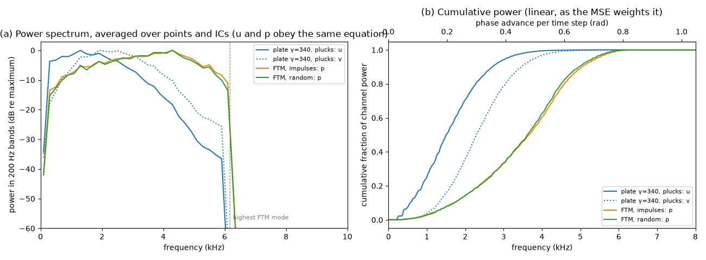
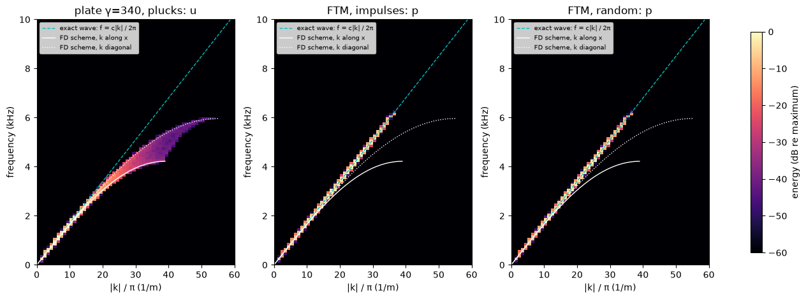
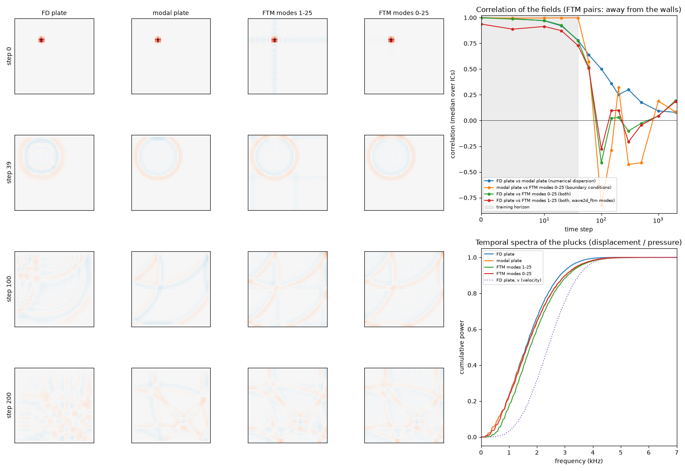

# Plate γ=340 and FTM 2D wave: spectra and plucks

In the [full-spectrum sweep](../full-spectrum-sweep/README.md), the models trained on the FTM 2D wave dataset and on the plate with γ=340, κ=0 behave differently, although both datasets model 2D waves at 340 m/s.
For example, the full-spectrum FRNN stays accurate for 2000 steps on the FTM dataset, but it diverges on the plate.
This document examines the differences between the two datasets:

1. the boundary conditions of the two solvers;
2. the temporal frequency content of the datasets, and how to represent it;
3. FTM plucks that agree with the plate's plucks, to compare the two solvers with the same initial conditions.

All results use the existing extrapolation datasets (30 trajectories of 2000 steps, data seed 5), plus solutions of the same plucks with two other solvers.

## Summary

1. **Bandwidth does not explain why the plate is more difficult.**
   The plate plucks have less high-frequency content than the FTM data: 90% of the plate's displacement power is below 2.7 kHz, but 90% of the FTM pressure power is below 5.0 kHz.
2. **The plate data has numerical dispersion; the FTM data has none.**
   With κ = 0, the plate PDE is the ideal wave equation, but the finite-difference Laplacian on the 40 x 38 grid makes the frequency of each mode too low, by an amount that depends on the wavenumber and its direction.
   65% of the plate's displacement energy is in modes with a frequency error of more than 1%.
   The FTM solves each mode exactly, at f = c|k| / 2π.
3. **The FTM can make plucks, but it needs the modes with index 0.**
   With the modes of `WaveSolver2D` (indices 1–25), 40% of the pluck (in norm) cannot be represented, because the modes have no mean and no profiles that are constant in x or y.
   With the indices 0–25 (without the static (0, 0) mode), only the mean is missing (8%).
   The FTM plucks have approximately the same temporal spectrum as the plate plucks.
4. **In the training horizon, the difference between the plate and the FTM is the numerical dispersion; the boundary conditions act only after the first wall reflection.**
   An exact modal solution of the same plate (no numerical dispersion) and the FTM plucks agree fully away from the walls up to step 39 (correlation 1.00).
   After the first reflections reach this region (between steps 39 and 60), the two become strongly anti-correlated (−0.82 at step 100), because u = 0 walls invert the reflected wave and rigid walls do not.
   The finite-difference plate and the exact plate diverge from the start, to a correlation of 0.78 at step 39 and 0.25 at step 200.

These results identify the differences between the datasets; they do not show which difference makes the learning more difficult.
The [proposed experiments](#proposed-experiments) can show that.

## The two solvers

| | Plate (`LinearPlateSolver`), γ=340, κ=0, no damping | FTM (`WaveSolver2D`) |
|---|---|---|
| PDE | u_tt = γ² ∇²u (the bending term κ² ∇⁴u is 0) | Acoustic wave equation in (p, vx, vy), c = 340 m/s |
| Boundary conditions | u = 0 at the walls (`bc="clamped"`, the default; as implemented, it gives the same matrices as simply supported) | Rigid walls, ∂p/∂n = 0 |
| Spatial modes | sin(mπx / Lx) sin(nπy / Ly) | cos(mπx / Lx) cos(nπy / Ly), m, n = 1–25 only |
| Space | 5-point finite-difference Laplacian on the 40 x 38 grid | Exact modes; the grid only samples the output |
| Time | `solve_ivp` (DOP853, rtol 1e-12): exact for practical purposes | Exact per mode |
| Damping | None (energy is constant) | Artificial damping 1/s (6% of the power is lost in 1500 steps) |

The finite-difference scheme replaces −k² by −(4/h²) sin²(kh/2) along each axis, so its angular frequency is

ω_FD = 2c √( sin²(kx hx / 2) / hx² + sin²(ky hy / 2) / hy² ),

instead of ω = c|k|.
For small kh, the relative error is approximately (kh)²/24.
On this grid, the error is more than 1% for wavelengths shorter than approximately 13 grid points, and the error is larger along the axes than along the diagonal.

## How to represent the temporal frequency content

1. **Average the power over all grid points and all ICs.**
   For a linear modal system, the spectrum at one point is the sum of the mode lines, weighted by the mode shapes at that point.
   The modes are orthogonal, so the power averaged over the whole grid is the energy of each mode at its frequency, independent of the observation point.
   An average of magnitudes, or of a small number of points, does not have this property.
2. **Compare the plate displacement u with the FTM pressure p.**
   The FTM starts with an initial pressure and zero particle velocity, so ∂p/∂t = −ρc² ∇·v = 0 at t = 0.
   The pressure obeys the same scalar wave equation as u, so an FTM state "p = f, at rest" is the same initial-value problem as a plate pluck "u = f, at rest".
   The plate velocity v = ∂u/∂t has the spectrum of u multiplied by ω² (+6 dB per octave); the figures show it as a dotted line.
3. **Use the 2000-step trajectories, and show the envelope.**
   A 40-step window gives a frequency resolution of 1.2 kHz, which is too coarse.
   Both systems are approximately lossless, so the energy per mode is constant in time, and a 2000-step window shows the same distribution with a resolution of 24 Hz.
   The quantiles of steps 0–499 and 1500–1999 are equal (table below), which confirms this.
   The raw spectrum is a set of mode lines, so the figures show the power in 200 Hz bands (dB, for the band limits and the floor) and the cumulative power (linear).
4. **Show the cumulative power as the loss weights it.**
   The models predict each channel normalised by its standard deviation, and the loss is a linear MSE.
   Thus the cumulative fraction of the channel power shows which frequencies the loss weights.
   The top axis gives the phase advance per time step, 2πf / fs, which the one-step operator of the model must apply.
5. **Separate the modes from the dispersion with a wavenumber–frequency map.**
   A temporal spectrum mixes two properties: which modes the ICs excite, and the frequency of each mode (the dispersion relation of the solver).
   A transform into the solver's own spatial modes (DST-I of the interior points for the plate, DCT-I of all points for the FTM) and an FFT in time separate them.

## Results: spectra of the extrapolation datasets



Frequency below which a fraction of the channel power lies:

| Dataset | Channel | 50% | 90% | 99% |
|---|---|---|---|---|
| Plate γ=340, plucks | u | 1.51 kHz | 2.71 kHz | 3.79 kHz |
| | v | 2.30 kHz | 3.48 kHz | 4.44 kHz |
| FTM, impulses | p | 3.67 kHz | 5.06 kHz | 5.93 kHz |
| | vx | 3.62 kHz | 5.04 kHz | 5.93 kHz |
| FTM, random | p | 3.62 kHz | 4.97 kHz | 5.81 kHz |
| | vx | 3.58 kHz | 4.94 kHz | 5.81 kHz |

Both datasets have no power above approximately 6.2 kHz: the FTM because its highest mode (m = n = 25) is at 6.17 kHz, the plate because the finite-difference dispersion puts the grid's highest wavenumbers below approximately 6 kHz.
In the FTM data, the impulses and the random fields have the same spectrum.

Stationarity (50% and 90% quantiles in steps 0–499 and 1500–1999):

| Dataset | Steps 0–499 | Steps 1500–1999 | Power ratio |
|---|---|---|---|
| Plate, u | 1.54 / 2.69 kHz | 1.54 / 2.69 kHz | 1.001 |
| FTM, impulses, p | 3.65 / 5.09 kHz | 3.65 / 5.09 kHz | 0.939 |
| FTM, random, p | 3.65 / 4.99 kHz | 3.65 / 4.99 kHz | 0.939 |



The FTM energy is on the line f = c|k| / 2π up to |k| ≈ 36π.
The plate energy follows the finite-difference dispersion: above |k| ≈ 20π it is below the line, and its frequency depends on the direction of k (the band between "along x" and "diagonal").

Energy share of the plate modes by the error of the finite-difference frequency:

| Channel | Frequency error > 1% | > 5% | Phase lag > π after 39 steps | After 2000 steps |
|---|---|---|---|---|
| u | 0.65 | 0.13 | 0.008 | 0.64 |
| v | 0.92 | 0.37 | 0.041 | 0.92 |

Thus, in the training horizon the phase error is small, but after 2000 steps most of the plate's energy is more than half a period away from an ideal wave.

## Results: plucks in four solvers

The four solvers start from the 30 plucks of the plate extrapolation dataset (same centres and widths, regenerated from numpy seed 5; the first 10 are used):

- **FD plate:** the dataset.
- **Modal plate:** the same PDE, boundary conditions, grid and plucks, solved exactly in the sine modes that the grid resolves (m ≤ 38, n ≤ 36); each mode evolves as a cos(c|k|t).
  The initial coefficients are the sine (Sturm–Liouville) transform of the continuous pluck.
- **FTM, modes 1–25:** `WaveSolver2D`, with an initial pressure equal to the pluck, at rest.
  The modal input is the integral of the pluck times the eigenfunction `Ka3`; `create_impulse` uses `Ka3` at one point, which is the same integral for a delta.
- **FTM, modes 0–25:** the same, with the modes that have one index 0 added (not the static (0, 0) mode).
  The norm of cos(0) over a side is two times the norm of the other modes, so the scaling factor of these modes is multiplied by 2.



Initial fields (median relative error over 10 ICs):

| Solver | Error against the part of the pluck that the modes can represent | Part of the pluck that the modes cannot represent |
|---|---|---|
| Modal plate | 0.023 (against the pluck on the grid) | – |
| FTM, modes 1–25 | 0.075 | 0.40 (mean and profiles constant in x or y) |
| FTM, modes 0–25 | 0.072 | 0.08 (mean) |

Correlation of the fields (median over 10 ICs; for the FTM pairs, the points at least 5 grid points from the walls):

| Pair | Step 10 | 20 | 39 | 60 | 100 | 200 | 1999 |
|---|---|---|---|---|---|---|---|
| FD plate vs modal plate (numerical dispersion only) | 0.97 | 0.92 | 0.78 | 0.64 | 0.50 | 0.25 | 0.08 |
| Modal plate vs FTM modes 0–25 (boundary conditions only) | 1.00 | 1.00 | 1.00 | 0.57 | −0.82 | 0.32 | 0.08 |
| FD plate vs FTM modes 0–25 (both) | 0.97 | 0.93 | 0.78 | 0.52 | −0.41 | 0.03 | 0.19 |
| FD plate vs FTM modes 1–25 (both, modes of `wave2d_ftm`) | 0.91 | 0.87 | 0.73 | 0.51 | −0.28 | 0.10 | 0.18 |

Temporal spectra of the plucks (50 / 90 / 99% of the power, same 10 ICs): FD plate 1.61 / 2.83 / 3.82 kHz; modal plate 1.63 / 3.05 / 4.37 kHz; FTM modes 1–25 1.75 / 3.12 / 4.27 kHz; FTM modes 0–25 1.66 / 3.02 / 4.20 kHz.
The finite-difference scheme moves the upper part of the spectrum down, as its dispersion relation shows.

## Interpretation

- The models do better on the FTM dataset, which has more high-frequency content, so the bandwidth of the data is not the cause.
- The plate data has two properties that the FTM data does not have:
  - **numerical dispersion:** the frequency of a mode is a function of the direction of k, not only of |k|, and the high wavenumbers move slowly;
  - **u = 0 walls:** reflected waves change sign.
  An FNO layer applies one complex channel-mixing matrix per Fourier mode of the padded grid, so in principle it can represent either property.
  The data does not show which property, if any, makes the learning more difficult.
- The FTM dataset also uses different initial conditions (impulses and random fields, which are wideband) and has a small artificial damping.
  Plucks in the FTM remove the difference of initial conditions.

## Proposed experiments

Each experiment changes one property and keeps the plucks, the grid and the training set-up of the sweep:

1. **Exact plate (no numerical dispersion):** train on plucks of the modal plate.
   Compared with the FD plate, this isolates the numerical dispersion.
   The `ModalPlate` class in `plucks.py` is sufficient to make the dataset; a finite-difference solution on a finer grid, subsampled to 40 x 38, is an alternative.
2. **FTM plucks (modes 0–25):** train on FTM plucks.
   Compared with experiment 1, this isolates the boundary conditions; compared with the FTM 2D wave dataset, it isolates the initial conditions.
3. **Velocity channel:** the FTM dataset has three channels (p, vx, vy); the plate has two (u, v).
   If experiments 1 and 2 do not explain the difference, train the FTM with (p, ∂p/∂t) to agree with the plate.

## Limits

- The pluck comparisons use 10 of the 30 ICs, and the tables give medians; `plucks.py` takes the number of ICs as an argument.
- The modal plate truncates the pluck at the modes that the grid resolves; its initial field differs from the pluck on the grid by 2.3%.
- The FTM plucks with modes 0–25 use a mode set that is different from the `wave2d_ftm` dataset; the scripts do not change `WaveSolver2D`.

## Reproduce

From the repository root, with the datasets in `$FA2023_OUTPUT/datasets`:

```bash
uv sync --extra cpu
uv run --extra cpu python docs/results/plate-vs-wave2d-spectra/spectra.py $FA2023_OUTPUT/datasets   # fig_temporal_spectra.png, fig_wavenumber_frequency.png
uv run --extra cpu python docs/results/plate-vs-wave2d-spectra/plucks.py $FA2023_OUTPUT/datasets 10 # fig_plucks.png
```

The scripts write the figures next to themselves and print the numbers of the tables.
